# k8s.galaxy

Terminal command center for Kubernetes — Rust + Ratatui. Three live views of a cluster:

| View | Key | What it shows |
| --- | --- | --- |
| **GEO MAP** | `1` | Braille world map, nodes pinned to their datacenters, sonar beacons per site, links to the control plane with packets flowing along them. Zoom/pan with a smooth camera. |
| **GALAXY** | `2` | Each node is a star system (control plane = magenta, worker = amber, NotReady = red flicker); pods orbit as planets, one orbit per namespace; failing pods flare red. |
| **RADAR** | `3` | Rotating sweep with phosphor trail. Healthy nodes on the rim, failing pods/nodes close to the center ("hostile contacts"). |

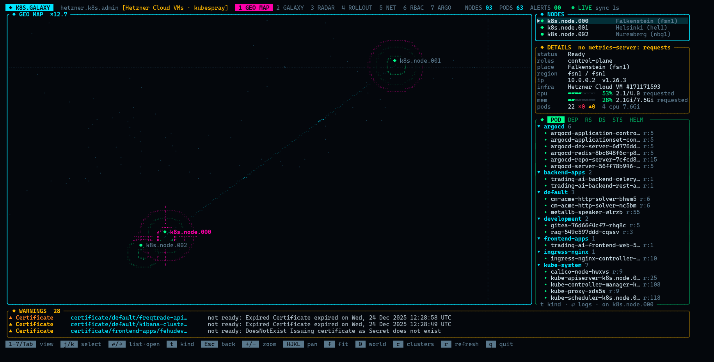

Sidebar: nodes → details → resource list. Bottom ticker: latest `Warning` events.

The resource list is split into namespace sections (with failing/degraded counts) and switches with `t`/`T` between:

| Tab | Scope | `Enter` |
| --- | --- | --- |
| `POD` | pods on the selected node | logs |
| `DEP` `RS` `DS` `STS` | Deployments, ReplicaSets (scaled-to-0 ones hidden), DaemonSets, StatefulSets, cluster-wide, `ready/desired` | its pods with status, node, restarts |
| `HELM` | Helm 3 releases (current revision), chart, revision/status | chart, app version, status, workloads in its namespace |

Selecting a workload or release highlights its pods in the Galaxy and Radar views.

## Screenshots

Live Hetzner cluster unless marked *demo* (`--demo`, for what that cluster does not run: Argo Rollouts, metrics-server).

| | |
| --- | --- |
| 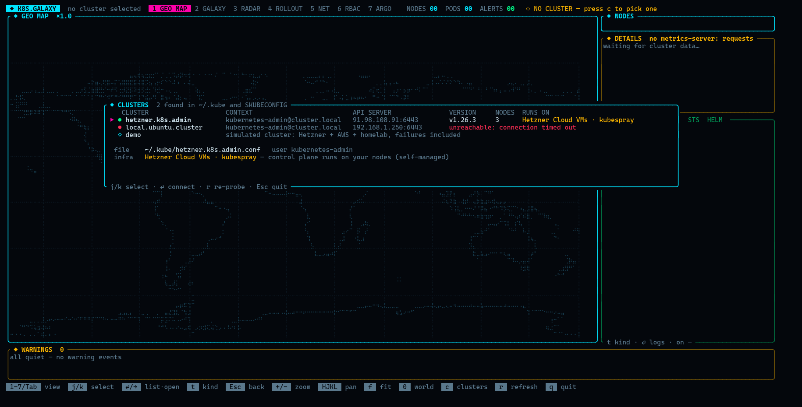 **Cluster picker** — every context in `~/.kube`, probed | 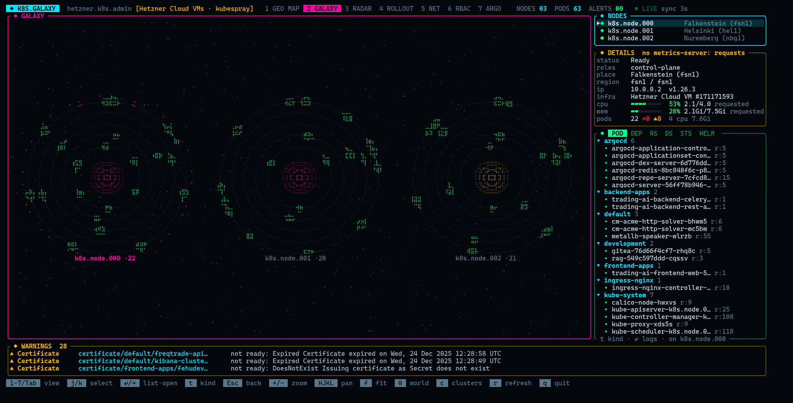 **Galaxy** — nodes as stars, pods orbiting per namespace |
| 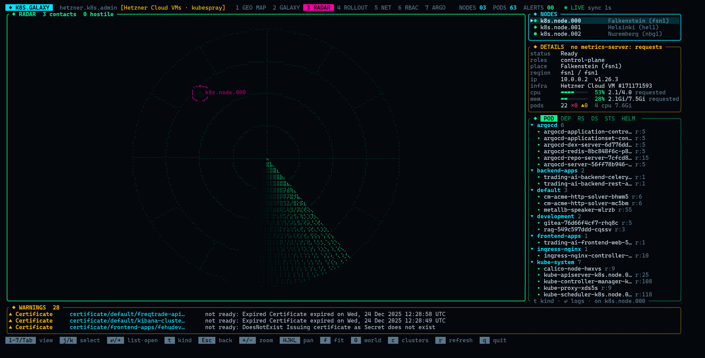 **Radar** — failing pods and nodes drift to the center | 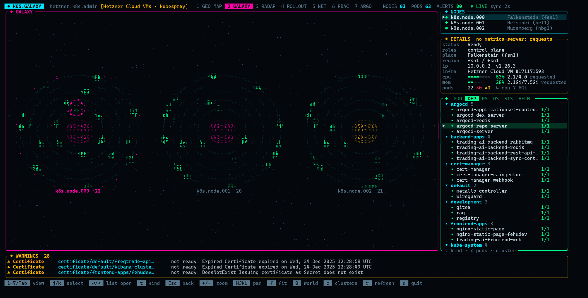 **Resources** — Deployments by namespace, requests vs allocatable |
| 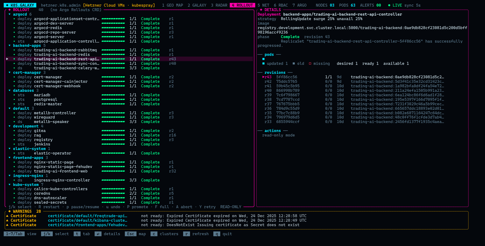 **Rollouts** — revisions of a Deployment | 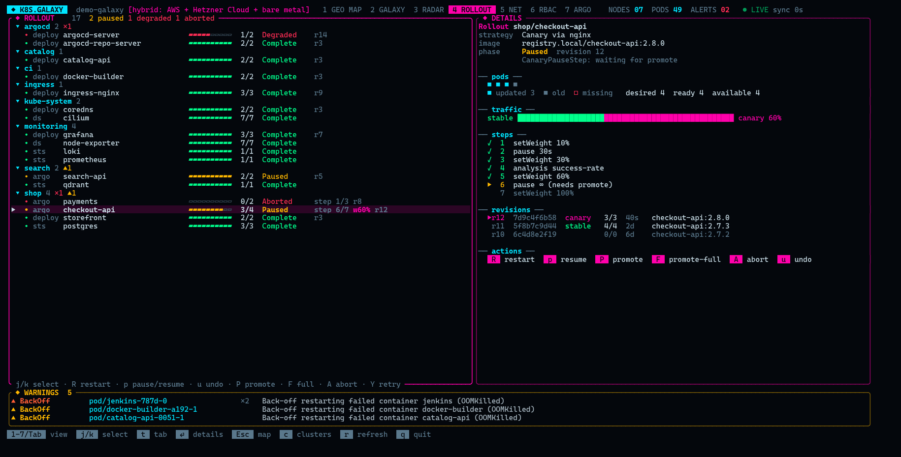 **Argo Rollouts canary** (*demo*) — steps, traffic split |
| 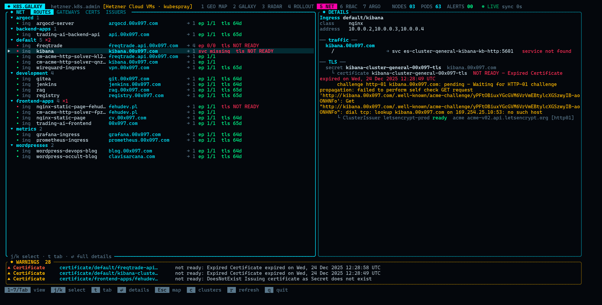 **Routes** — host → service → endpoints, TLS chain | 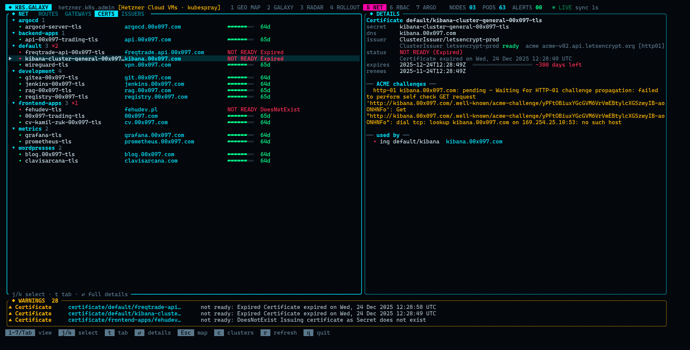 **Certificates** — expired cert with its failing ACME challenge |
| 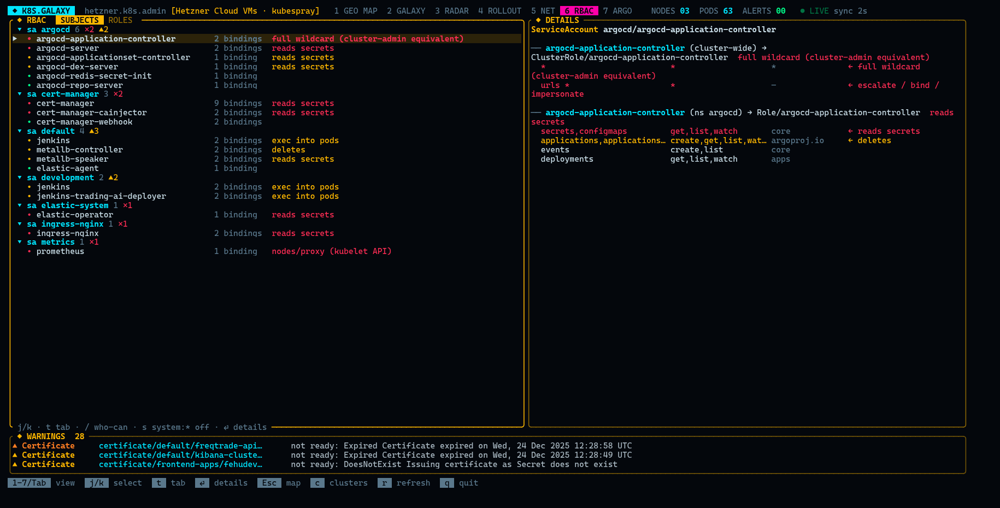 **RBAC** — subjects rated by risk | 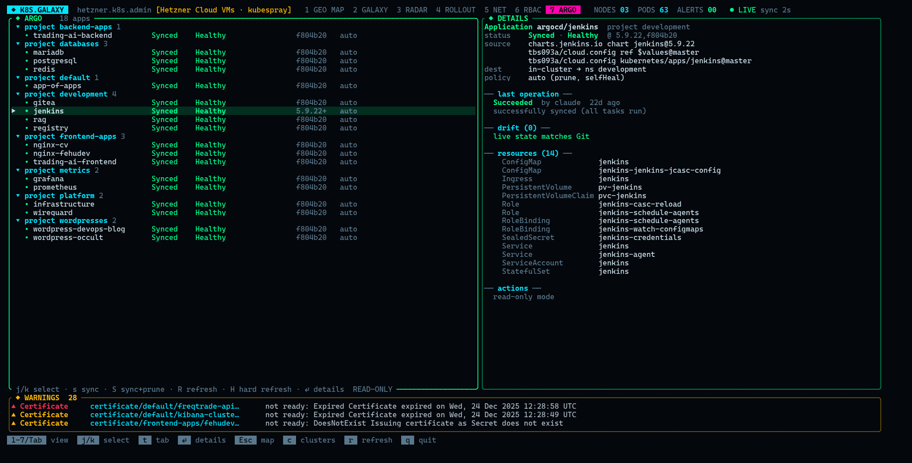 **Argo CD** — sync, health, drift, resources |
| 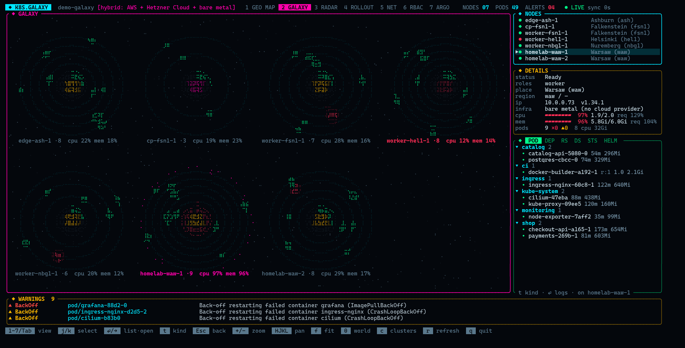 **Metrics** (*demo*) — load arcs, a node running hot | |

## Run

```bash
cargo run --release                                             # pick a cluster from ~/.kube (see Clusters)
cargo run --release -- --demo                                   # simulated cluster
cargo run --release -- --kubeconfig ~/.kube/prod.conf \
  --hcloud-env-file ./infra/.env   # locations from the Hetzner API (file with HCLOUD_TOKEN=...)
cargo run --release -- --kubeconfig ~/.kube/homelab.conf --home 52.23,21.01
```

| Flag | |
| --- | --- |
| `--kubeconfig PATH` / `--context NAME` | open this cluster directly instead of the picker |
| `--demo` | fake cluster across Hetzner fsn1/nbg1/hel1/ash + homelab in Warsaw |
| `--home LAT,LON` | where to put nodes that have no location info (homelab) |
| `--place KEY=LAT,LON` / `--place KEY=PLACE` | pin a node name / region / zone / location key, e.g. `web.node.01=fsn1` (repeatable) |
| `--cloud hetzner,aws,gcp,azure` | ask these providers where VMs live (default `auto`, `none` disables) |
| `--hcloud-env-file PATH` | read `HCLOUD_TOKEN` from a dotenv file (else the env var is used) |
| `--aws-region R` | EC2 regions to list (repeatable/comma separated; default: CLI's region) |
| `--gcp-project P` | GCP project (default: gcloud's configured one) |
| `--cloud-interval SECS` | inventory refresh (default 300) |
| `--interval SECS` | poll interval (default 5) |
| `--fps N` | animation frame rate (default 30) |

## Clusters

Without `--kubeconfig`/`--context`, k8s.galaxy reads every kubeconfig it can find — the files in `$KUBECONFIG`,
`~/.kube/config` and any other file in `~/.kube/` (backups like `*.bak`, `*.old`, `*~` are skipped) — and lists
every context. With one cluster it connects right away; with several it opens the **cluster picker**, which is
also on `c` at any time. Each cluster is probed in the background (read-only: `/version`, nodes,
ClusterRoleBinding names): reachable or not, Kubernetes version, node count and what it runs on. `Enter`
switches clusters live, `r` probes again; the last row is the demo.

What it runs on is shown in the picker, as a badge in the header and per node (`infra` in the details panel):

| Badge | Recognised by |
| --- | --- |
| `managed EKS` / `GKE` / `AKS` / `DOKS` / `LKE` / `OKE` / `Kapsule` / `OVH MKS` / … | API server host (`*.eks.amazonaws.com`, `*.azmk8s.io`, …), version suffix (`-eks-`, `-gke.`), node-pool labels — and no control-plane nodes visible |
| `Hetzner Cloud VMs` / `AWS VMs` / … | self-managed control plane on one provider's VMs: node `providerID`, or a match in the cloud inventories (so clusters without a cloud controller are recognised too) |
| `bare metal` | no node has any cloud provider (also VMs on your own hypervisor) |
| `local kind` / `minikube` / `k3d` / `Docker Desktop` | dev clusters on this machine |
| `hybrid: Hetzner Cloud + bare metal` | nodes of several kinds |

plus the distribution where it can be told: `kubespray`, `kubeadm`, `k3s`, `rke2`, `Talos`, `OpenShift`, `MicroK8s`, `Tanzu`.

## Where a node lands on the map

First match wins:

1. annotation `k8s.galaxy/geo: "52.23,21.01"`
2. `--place <node-name>=…`
3. label `k8s.galaxy/location` (e.g. `waw`, `fsn1`) → `--place` or built-in table
4. `topology.kubernetes.io/region` → same lookup (Hetzner CCM sets `fsn1`/`nbg1`/`hel1`/`ash`/`hil`/`sin`)
5. `topology.kubernetes.io/zone`, also normalized (`fsn1-dc14` → `fsn1`, `us-east-1a` → `us-east-1`)
6. **cloud provider** — the VM backing the node (see below)
7. `--home`
8. otherwise "unplaced" (still visible in Galaxy/Radar and the sidebar)

Built-in table covers Hetzner, AWS, GCP, Azure regions and a few Polish cities (`waw`, `krk`, `wro`, `gdn`, `poz`) — see `src/geo.rs`.

```bash
kubectl label node homelab-1 k8s.galaxy/location=waw
kubectl annotate node edge-1 k8s.galaxy/geo=50.06,19.94
```

## Cloud providers

Nodes don't need any labels: k8s.galaxy can ask the provider where each VM runs, and shows the match in the
details panel (`cloud  hetzner web-node-01 #12345`). Inventories refresh every `--cloud-interval`; API errors appear
in the warnings ticker as `CloudAPI provider/<name>` and never stop the dashboard.

| Provider | How | Auth |
| --- | --- | --- |
| Hetzner | REST `GET /v1/servers` (location + exact datacenter coordinates) | `HCLOUD_TOKEN` or `--hcloud-env-file` |
| AWS | `aws ec2 describe-instances` | whatever the `aws` CLI uses (profile, SSO, env) |
| GCP | `gcloud compute instances list` | `gcloud auth` / ADC |
| Azure | `az vm list -d` + `az vmss list` (AKS scale sets) | `az login` |

Node ↔ instance matching, first hit wins: `spec.providerID` (`hcloud://`, `aws://`, `gce://`, `azure://`), then
name (`web.node.01` = `web-node-01`, EC2 private DNS, Azure computer name), then any shared IP.
AWS and GCE providerIDs already contain the zone, so those clusters land on the map with no API call at all.

`auto` mode queries Hetzner when a token is available and Azure when nodes carry `azure://` providerIDs;
AWS/GCP are queried only when listed in `--cloud`.

## Operations views

`4 ROLLOUT`, `5 NET`, `6 RBAC` and `7 ARGO` take the full width: entries in namespace sections on the left, details of the selected one on the right, `Enter` opens them full screen.

**Rollouts** — Deployments, StatefulSets, DaemonSets and Argo Rollouts (when the CRD exists) with progress, phase (Complete / Progressing / Paused / Degraded / Aborted), revisions (ReplicaSets with image and replicas; Argo stable/canary/active/preview), canary steps with the current one, and traffic weight.

| Key | Action | Applies to |
| --- | --- | --- |
| `R` | restart (new pod template annotation / Argo `restartAt`) | all |
| `p` | pause / resume | Deployment, Rollout |
| `u` | undo to the previous revision (what `kubectl rollout undo` does) | Deployment, Rollout |
| `P` | promote: unpause, or skip the current step | Rollout |
| `F` | promote-full: skip all steps and analysis | Rollout |
| `A` / `Y` | abort / retry | Rollout |

Every action asks for confirmation. `--dry-run` sends them as server-side dry-runs (validated by the API server, nothing changes); `--read-only` disables them.

**Net** — tabs `ROUTES` (Ingress, HTTPRoute, GRPCRoute), `GATEWAYS`, `CERTS`, `ISSUERS`. A route shows the whole chain: host → path → Service:port → ready endpoints, and TLS secret → cert-manager Certificate (ready, days left, renewal, pending ACME challenges) → Issuer. Missing services, empty endpoints, missing TLS secrets, failed or expiring certificates (< 14 days) are flagged; certificate problems also go to the warnings ticker. Gateway API and cert-manager are detected; without them those tabs say so.

**RBAC** — tabs `SUBJECTS` (users, groups, ServiceAccounts → bindings → roles → rules) and `ROLES` (rules, who is bound, unused roles). Rules are rated: wildcards, reading secrets, `pods/exec`, `nodes/proxy`, escalate/bind/impersonate and editing RBAC are red; bindings to ServiceAccounts that do not exist and permissions on `default` SAs are flagged. `/` asks *who can* — `get secrets`, `create pods/exec shop`, `patch deployments.apps`. `s` shows `system:*` objects.

**Argo** — Argo CD Applications grouped by project: sync (Synced / OutOfSync), health, synced revision(s), auto/manual policy, the last operation (phase, who, when, message — e.g. why a sync failed), conditions, **drift** (resources out of sync with Git) and all managed resources with their health. Multi-source apps show every source.

| Key | Action |
| --- | --- |
| `s` | sync (sets `.operation`, like `argocd app sync`; asks first) |
| `S` | sync with prune — deletes resources no longer in Git (asks first) |
| `R` / `H` | refresh / hard refresh (`argocd.argoproj.io/refresh` annotation) |

## Resource usage

With metrics-server (`metrics.k8s.io`) installed: node CPU/memory bars in the details panel, per-pod usage in the pod list, load arcs around each star in the Galaxy (CPU inner, memory outer, green → amber → red) and planets sized by memory in use. Without it, the details panel shows **requests vs allocatable**, which every cluster has.

Traffic, RBAC and Helm refresh every 20 s in a background task (Helm release payloads are fetched once per revision), so a slow API server never stalls the live view.

## Keys

`1-7`/`Tab` view · `j/k` select · `Enter`/`→` into the list, `Enter` again = open · `t`/`T` list kind · `l` pod logs · `Esc`/`←` back · `+/-` zoom on selected node · `HJKL` pan · `f` fit to nodes · `0` world · `c` clusters · `r` refresh now · `q` quit

## Layout

```
src/
  main.rs     CLI, terminal loop
  app.rs      state, camera, key handling
  source.rs   kube-rs poller (nodes, pods, warning events, logs) on tokio
  demo.rs     simulator for --demo
  cloud.rs    provider inventories (Hetzner REST, aws/gcloud/az CLIs) + node matching
  geo.rs      location resolution + region table
  model.rs    snapshot types, health
  gitops.rs   Argo CD Applications, sync/refresh
  infra.rs    managed / cloud VMs / bare metal / local detection, distributions
  kubeconfigs.rs  kubeconfig discovery in ~/.kube and $KUBECONFIG, cluster probes
  metrics.rs  metrics-server usage, quantity parsing
  ops.rs      rollouts, traffic (Ingress/Gateway API/cert-manager), RBAC, rollout actions
  demo_ops.rs simulated rollouts/traffic/RBAC for --demo
  fx.rs       colors, fades, pulses, noise — seed of a reusable `tui-fx`
  ui/         map, galaxy, radar, panels, ops (rollouts/net/rbac/argo views), cluster picker
```

RBAC needed: `list` on nodes, pods, events, deployments, replicasets, daemonsets, statefulsets (cluster-wide), `get` on `pods/log`, `list` on secrets for the Helm tab (releases are read from `owner=helm` Secrets; without access the tab shows a warning and stays empty). The operations views add `list` on ingresses, services, endpointslices, roles, rolebindings, clusterroles, clusterrolebindings, serviceaccounts, Gateway API / cert-manager / Argo Rollouts objects, Argo CD `applications` (+ `patch` for sync/refresh), `nodes`/`pods` in `metrics.k8s.io`, and `patch` on the workloads (plus `rollouts/status`) for actions.

## Ideas / next

- Prometheus metrics (request rate → packet speed, error rate on routes)
- Network attack layer on the map (firewall/Falco/Suricata sources as incoming arcs)
- Watch API instead of polling
- Extract `fx.rs` + canvas helpers into a `tui-fx` crate
